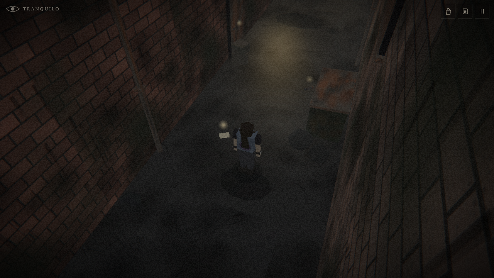

# EL SUEÑO — Capítulo I: La Ciudad Vacía

Браузерный психологический хоррор в формате кинематографичного квеста (в духе Telltale / Snatcher) для изучения испанского языка.

Вы просыпаетесь в пустом туманном городе и не помните своего имени. Телефон в будке называет вас «paciente siete», слепой фонарщик просит апельсиновую газировку, а на стене переулка написано «NO MIRES ATRÁS». Вы не ходите — смотрите на фиксированные кадры, нажимаете на активные точки, читаете документы и выбираете реплики. **Весь игровой текст — на испанском (Испания, уровень A1)**, и почти каждое препятствие решается пониманием фразы.



- Глава I: 5 зон, 11 кадров, погоня, загадка, финал.
- 76 слов в словаре с определениями на простом испанском; подсветка новых слов прямо в тексте.
- Cuaderno (документы и голоса), Archivo (факт / свидетельство / гипотеза), Ecos.
- Процедурная графика (three.js) и процедурный звук (Web Audio); озвучка через синтез речи браузера.
- Один HTML-файл без зависимостей: работает офлайн, двойным кликом.

## Как запустить:

Откройте **`dist/el-sueno.html`** двойным кликом — сервер не нужен. Версия с ходьбой (WASD и джойстик) — `dist/el-sueno-walk.html`, онлайн — `/walk/`. Нужен браузер с WebGL (Chrome, Firefox, Edge, Safari). Рекомендуются наушники.

Если браузер ограничивает `file://`, можно поднять локальный сервер:

```sh
npm run serve   # http://localhost:8080/el-sueno.html
```

**Управление:** клик/касание по кружкам — осмотреть, прочитать, поговорить; кнопки «→» внизу — сменить место. Клавиатура: `E`/`Space` — дальше, `1–9` — выбрать ответ, `Tab` — инвентарь, `J` — Cuaderno, `F` — фонарь, `M` — звук, `Esc` — пауза. Нажатие на подчёркнутое слово показывает его значение.

## Как собрать

Нужен Node.js 18+.

```sh
npm install      # ставит three@0.149.0
npm run build    # → dist/el-sueno.html и dist/el-sueno-walk.html (~570 KB каждый)
```

`build.js` собирает каждую версию esbuild'ом из ES-модулей (точка входа `src/main.js` или `versions/walk/src/main.js`, three.js через `import`) в один IIFE и встраивает его в `shell.html` — получается один HTML, который открывается через `file://`. Подробнее — [docs/ARCHITECTURE.md](docs/ARCHITECTURE.md).

## Как тестировать

Сквозной тест `tests/e2e.py` проходит всю главу в headless Chromium (Playwright, Python): 52 проверки на десктопе, 54 в мобильной эмуляции (тач, 667×375, затем портрет 390×760). Скриншоты — в `tests/screenshots/`.

Один раз установить зависимости (Python 3.9+):

```sh
python3 -m venv .venv
source .venv/bin/activate
npm run test:setup   # pip install -r requirements.txt + браузер Chromium
```

Запуск (с активированным `.venv`):

```sh
npm test              # сборка + десктоп
npm run test:mobile   # сборка + мобильная эмуляция
npm run test:walk     # сборка + версия с ходьбой: прохождение (десктоп) и тач-управление
npm run test:saves    # сборка + сохранения квеста и ходьбы не мешают друг другу
npm run test:all      # всё подряд
```

Каждый прогон занимает несколько минут: таймеры погони и кат-сцены идут в реальном времени. При любой упавшей проверке скрипт завершается с кодом 1. Переменная `CHROME_PATH` позволяет использовать установленный Chrome вместо Chromium из Playwright, `E2E_URL` — проходить игру по http-адресу вместо `file://` (например, чтобы проверить заголовки деплоя).

## Как задеплоить

Игра публикуется на **Cloudflare Pages** через GitHub Actions: на каждый push в `main` — деплой (параллельно с e2e, от тестов не зависит), на каждый PR — preview-деплой и e2e. Заголовки безопасности и кеширования — в `deploy/cloudflare/_headers`.

```sh
npm run build:site  # site/: index.html (квест), walk/index.html (ходьба), _headers, 404.html
npm run deploy      # ручной деплой через wrangler (минуя CI, только в крайнем случае)
```

Первая настройка (проект, токен, секреты GitHub), свой домен и откат — в [docs/DEPLOY.md](docs/DEPLOY.md).

## Структура репозитория

```
├── src/
│   ├── shell.html     разметка и весь CSS, плейсхолдеры для скриптов
│   ├── data.js        контент: предметы, документы, словарь, архив, Ecos, загадка
│   ├── audio.js       процедурный звук и озвучка
│   ├── world.js       3D-мир, текстуры, камеры, модель героя, пост-эффект
│   ├── systems.js     сохранение, язык, инвентарь, архив, диалоги, загадка, интерфейс
│   ├── screens.js     11 кадров и система активных точек
│   └── game.js        сюжетные сценарии и класс Game
├── versions/walk/src/ версия с ходьбой: shell.html, world.js, systems.js, game.js
├── dist/              собранные игры: el-sueno.html, el-sueno-walk.html
├── tests/e2e.py       сквозной тест квеста (Playwright)
├── tests/e2e_walk.py, e2e_walk_mobile.py  тесты версии с ходьбой
├── tests/e2e_saves.py  сохранения двух версий
├── .claude/, .mcp.json  harness Claude Code: агенты, скиллы, хуки, Playwright MCP
├── docs/              документация (см. ниже)
├── deploy/cloudflare/ _headers и 404.html для Cloudflare Pages
├── scripts/site.js    подготовка каталога site/ для деплоя
├── .github/workflows/ CI: сборка, e2e, деплой
├── build.js           сборка esbuild → один HTML на версию
├── requirements.txt   зависимости тестов
├── HANDOFF.md         записка предыдущего разработчика
└── CHANGELOG.md
```

## Документация

| Документ | О чём |
|---|---|
| [ARCHITECTURE.md](docs/ARCHITECTURE.md) | модули, сборка, поток данных, игровой цикл, сцены, диалоги, сохранение |
| [GAME_DESIGN.md](docs/GAME_DESIGN.md) | концепция, карта сцен, полное прохождение, флаги, загадка, погоня, концовка |
| [LORE.md](docs/LORE.md) | мир, Орден, Проект Vigilia, персонажи; факт / свидетельство / гипотеза |
| [LANGUAGE_DESIGN.md](docs/LANGUAGE_DESIGN.md) | как испанский встроен в механики, словарь, план A2 → B1 |
| [CONTENT_GUIDE.md](docs/CONTENT_GUIDE.md) | как добавить сцену, точку, документ, слово, архив, Eco, диалог |
| [DEPLOY.md](docs/DEPLOY.md) | деплой на Cloudflare Pages, CI, домен, откат |
| [ROADMAP.md](docs/ROADMAP.md) | техдолг и глава II «El Hospital» |
