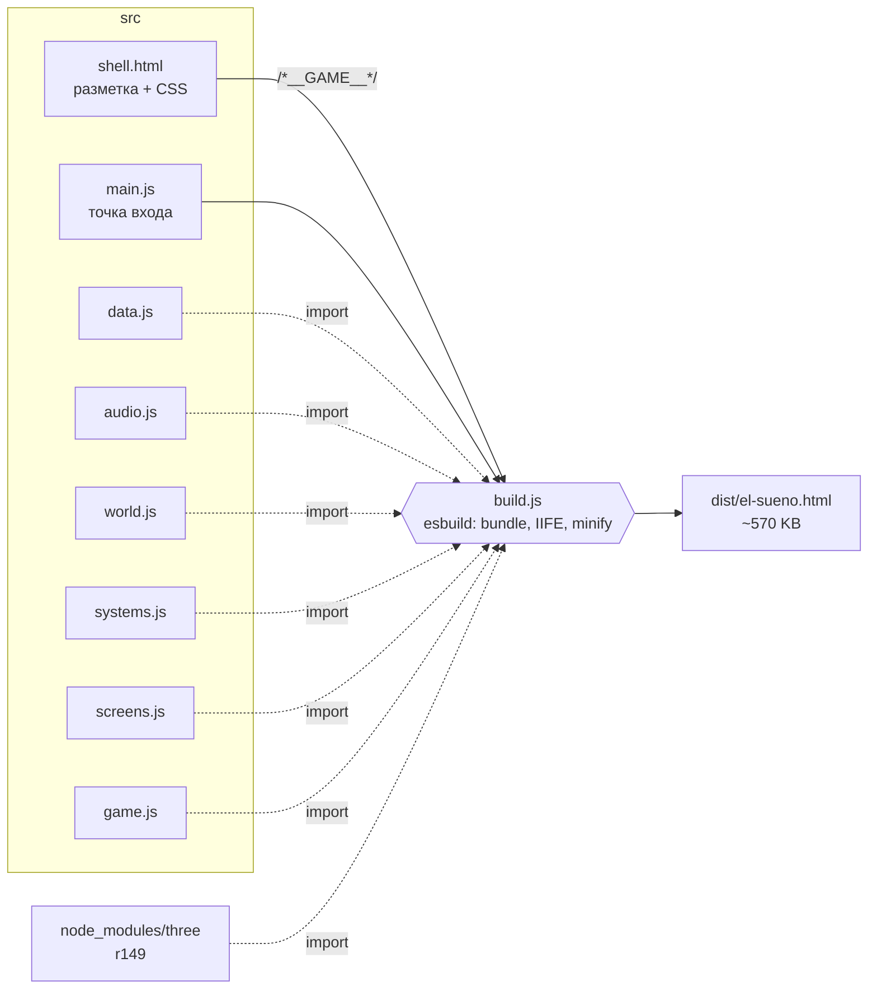
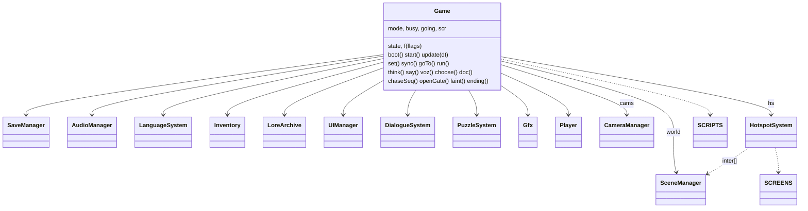
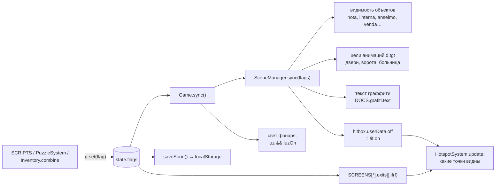
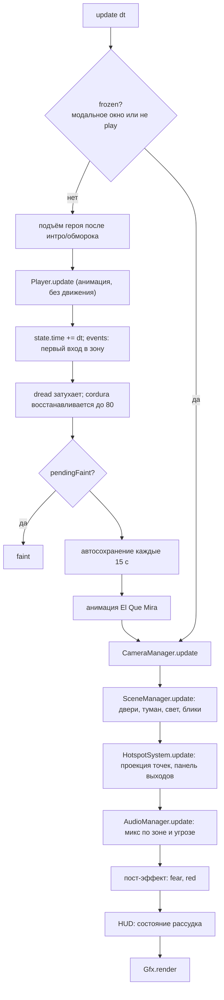
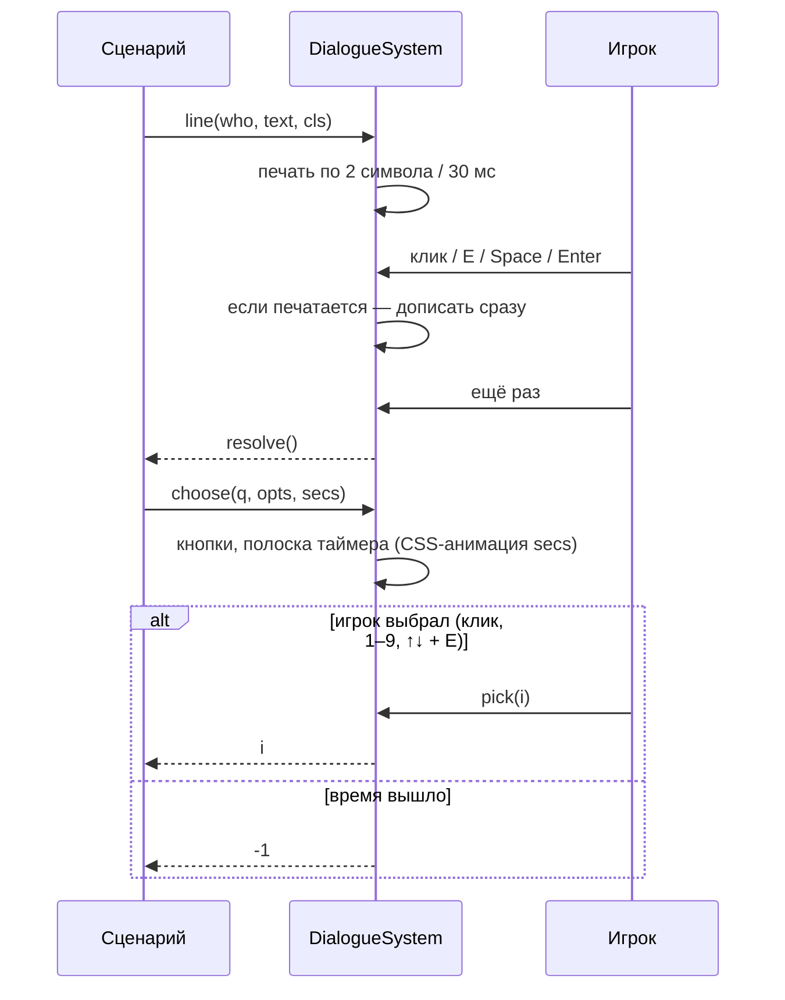

# Архитектура

## Обзор

Игра — один самодостаточный HTML-файл на версию. Код — ES-модули с явными `import`/`export`. `build.js` запускает esbuild (точная версия в `devDependencies`): bundle от `main.js` вместе с three.js (`import * as THREE from 'three'`, r149), формат IIFE, минификация, `target: es2020`. Результат встраивается в обычный `<script>` внутри `shell.html` (плейсхолдер `/*__GAME__*/`), поэтому файл работает через `file://`, без сервера и без `type="module"`.



Так же собирается версия с ходьбой: точка входа `versions/walk/src/main.js`, разметка `versions/walk/src/shell.html`; `data.js` и `audio.js` импортируются из `src/` (общие с квестом) → `dist/el-sueno-walk.html`. В ней нет `screens.js`: вместо кадров и активных точек — `InteractionSystem` (ближайший объект, луч от указателя), движение `Player.move` и погоня в реальном времени.

`build.js` экранирует `</script` внутри бандла, чтобы встроенный скрипт не закрылся раньше времени, и использует функцию-заменитель в `String.replace`, чтобы `$` в коде не интерпретировался как шаблон подстановки. `package.json` объявляет `"type": "module"`: так `node --check` (хук после правки) понимает `import`, а `build.js` и `scripts/site.js` сами написаны как ESM.

Глобальных объявлений нет. Для тестов `main.js` выставляет `window.__sueno` (экземпляр `Game`) и `__sueno.three` (`THREE.REVISION`).

## Модули

| Модуль | Импортирует | Экспортирует |
|---|---|---|
| `data.js` | — | `SAVE_KEYS`, `LEGACY_SAVE_KEY`, `SET_KEY`, `MAX_SLOTS`, `ZONES`, `ITEMS`, `DOCS`, `LEX`, `ARCHIVE`, `ECOS`, `SYMBOLS`, `PLATE_ORDER`, `PRAYER`, `SOLUTION` |
| `audio.js` | — (Web Audio, `speechSynthesis`) | `AudioManager` |
| `world.js` | `three`, `DOCS`, `SYMBOLS`, `clamp` | текстуры (`TEX`, `canvasTex`, `textTex`), `SceneManager`, `CAMS`, `CameraManager`, `Player`, `Gfx`, `zoneAt` |
| `systems.js` | данные, `SCREENS` (квест) | хелперы `$`, `esc`, `clamp`; `SaveManager`, `LanguageSystem`, `Inventory`, `LoreArchive`, `DialogueSystem`, `PuzzleSystem`, `UIManager` (+ `InteractionSystem` в версии с ходьбой) |
| `screens.js` | `three`, `$`, `esc`, `clamp` | `SCREENS`, `HotspotSystem` |
| `game.js` | всё выше | `SCRIPTS`, `DRINKS`, класс `Game`, `game` (текущий экземпляр, live binding) |
| `main.js` | `three`, `$`, `Game`, `game` | — (проверка WebGL, `new Game().boot()`, `window.__sueno`) |

`SceneManager` обращается к игре через `this.game` (передаётся в конструктор), а не через глобальную переменную. Циклические импорты (`systems.js` ↔ `screens.js`, `world.js` → `systems.js`) безопасны: на верхнем уровне модули только объявляют, всё вызывается после загрузки. Действия на верхнем уровне — только регистрация сценариев фресок и Eco в `SCRIPTS` (`game.js`, использует `ECOS`).



## Запуск

1. `main.js` проверяет WebGL; при ошибке показывает экран `#err` с текстом на испанском.
2. `new Game().boot()`: создаёт подсистемы, строит мир (`SceneManager.build`), игрока, камеры, точки; применяет флаги пустого состояния; вешает ввод; запускает `requestAnimationFrame`. Экземпляр доступен как `window.__sueno` (используется тестами).
3. Экран заголовка: «Continuar» (если есть сохранение), «Nueva partida» (с подтверждением, если сохранение есть), звук.
4. `Game.start(isNew)`: `audio.init()` (нужен жест пользователя), загрузка состояния, `setScreen(state.scr)`, `sync()`, интро для новой игры.

## Состояние и поток данных

Всё состояние партии — один сериализуемый объект `state` (`SaveManager.fresh`):

```js
{ v: 1, scr: 'callejon1', pos: {x, z, ry}, flags: {}, inv: [], docs: [], words: [],
  archive: [], ecos: [], decisions: [], log: [], cordura: 100, time: 0, tries: 0 }
```

`game.f` — ссылка на `state.flags`. Мир не хранит собственного состояния сюжета: он выводится из флагов.



`SceneManager.sync(f)` **идемпотентна**: её можно вызвать сколько угодно раз с одними и теми же флагами и получить тот же мир. На этом построено восстановление сохранения — после загрузки достаточно `sync()` и `snap()` (мгновенно поставить анимируемые объекты в целевое положение без интерполяции).

## Игровой цикл

`requestAnimationFrame` → `Game.update(dt)` (`dt` ограничен 50 мс; исключение в кадре логируется один раз и не останавливает цикл).



**Рендер** (`Gfx`): сцена рисуется в render target низкого разрешения (высота ≤ 540 px), затем полноэкранный шейдер добавляет хроматическую аберрацию, зерно, виньетку, сканлайны, тонирование; uniforms `fear` (угроза/низкий рассудок) и `red` (после открытия двери) усиливают эффекты.

**Камеры** (`CameraManager`): у каждого кадра своя фиксированная камера из `CAMS` (`pos`, `fov`, либо `fixed` — точка взгляда, либо слежение за героем с высотой `yoff`). `cams.force` временно перебивает камеру кадра (погоня — `pasaje2`, открытие двери — `verja`). В портретной ориентации FOV расширяется.

## Сцены и активные точки

`SCREENS` (`screens.js`) — 11 кадров. Кадр задаёт:

- `cam` — id камеры из `CAMS`;
- `at`, `ry` — где стоит и куда смотрит герой;
- `hs` — список id активных точек;
- `exits` — выходы: `{ label, to }` или `{ label, act: async g => … }`, с необязательным условием `if: f => …`.

Активная точка — это объект `it` из `SceneManager.addInter(id, x, z, opts)`: невидимый hitbox в 3D (его позиция проецируется на экран), блик-спрайт, глагол (`verb`) и условие `on()`. `HotspotSystem`:

- `build()` — при смене кадра создаёт по кнопке `.hs` на каждую точку кадра;
- `update()` — каждый кадр проецирует hitbox в экранные координаты (с прижатием к краям для портретного экрана), прячет выключенные точки и все точки, пока `!canAct()`; перерисовывает панель выходов `#nav`, только если изменилась её сигнатура;
- клик по точке → `Game.interact(it)` → `Game.run(SCRIPTS[id])`;
- клик по выходу → `goTo(to)` (затемнение + шаги) или `run(act)`.

`Game.canAct()` = режим `play`, нет сценария (`busy`), нет перехода (`going`), нет модального окна и диалога. Пока сценарий выполняется, точки и выходы скрыты — это защищает от двойных действий.

## Сценарии

`SCRIPTS` — по async-функции на точку; сюжет читается сверху вниз. Хелперы `Game`:

| Хелпер | Что делает |
|---|---|
| `think(...lines)` | мысли героя (серый текст, без имени) |
| `say(who, ...lines)` | реплики персонажа; пишутся в журнал «Voces» |
| `voz(...lines)` | голос в телефоне: курсив + `speechSynthesis` |
| `choose(q, opts, secs?)` | выбор; возвращает индекс, `-1` при истечении таймера |
| `doc(id)` | открыть документ, добавить в Cuaderno, выучить слова, флаг `doc_<id>` |
| `give(id)` | положить предмет (`false`, если инвентарь полон) |
| `set(flag, v)` | флаг + `sync()` + отложенное сохранение |
| `arch(id)` | открыть фрагмент архива |
| `decide(text)` | записать решение |
| `addCordura(d)` | изменить рассудок; при 0 — отложенный обморок |
| `wait(ms)`, `camShake(v)`, `dread` | пауза, тряска камеры, всплеск угрозы для звука/шейдера |

`Game.run(fn)` выставляет `busy`, ловит исключения сценария (`console.error('guion', …)`), в `finally` скрывает диалог и ставит сохранение.

## Диалоги и выбор с таймером

`DialogueSystem` (`systems.js`):



Детали:

- после допечатки текст размечается словами словаря; новые слова дают звук и тост;
- `UIManager.guard()/guarded()` — защита от «синтетического» click того же касания, которое открыло панель (на тач-устройствах);
- клик по подчёркнутому слову в варианте ответа в первый раз показывает подсказку и не выбирает вариант;
- кнопкам снимается фокус после клика, чтобы Space/Enter при следующей реплике не нажали их повторно.

## Ввод

| Клавиша | Действие |
|---|---|
| E / Space / Enter | продолжить реплику, выбрать подсвеченный вариант, закрыть документ |
| 1–9 | выбрать вариант |
| ↑ ↓ / W S | перемещение по вариантам |
| Tab | инвентарь |
| J | Cuaderno |
| F | фонарь (если собран) |
| M | звук вкл/выкл |
| Esc | закрыть окно / пауза |

Мышь и касание — по точкам, выходам, словам. Касание выставляет `body.touch` (другая раскладка подсказок). Жесты масштабирования, двойной тап и контекстное меню подавлены; прокрутка разрешена только в `.pbody`, `#docBody`, `.scroll`.

## Сохранение

`SaveManager` (`systems.js`):

- ключи `localStorage` (`data.js`): `SAVE_KEYS.quest` = `el_sueno_cap1_quest_v1` — партия квеста, `SAVE_KEYS.walk` = `el_sueno_cap1_walk_v1` — партия версии с ходьбой, `el_sueno_ajustes_v1` — громкость/звук/озвучка (общие для обеих версий). Ключ партии хранится в `SaveManager.key`;
- обе версии живут на одном домене (`/` и `/walk/`, а через `file://` — в одном origin) и делят `localStorage`, поэтому ключи партий разные;
- миграция: старое общее сохранение `LEGACY_SAVE_KEY` (`el_sueno_cap1_v1`) при первом запуске квеста переносится в `SAVE_KEYS.quest` (если там пусто) и удаляется (`SaveManager.migrate`). Версия с ходьбой его не читает и начинает с чистого листа. Формат `state` не менялся, `v` остаётся `1`. Покрыто `tests/e2e_saves.py`;
- если `localStorage` недоступен (приватный режим, `file://` с ограничениями) — хранение в памяти, на титульном экране предупреждение «Este navegador no guarda la partida.»;
- когда сохраняется: `saveSoon()` (debounce 400 мс) после флагов, предметов, архива, переходов; автосохранение раз в 15 с при `canAct()`; при открытии паузы; кнопка «Guardar partida»; `visibilitychange` (скрытие вкладки); `pagehide`.

**Валидация при загрузке** (`SaveManager.load`) — испорченное сохранение не ломает игру:

| Поле | Проверка |
|---|---|
| весь объект | JSON-объект с `v === 1`, иначе сохранение удаляется |
| `flags` | объект (не массив), иначе `{}` |
| `inv` | только существующие id `ITEMS`, не больше `MAX_SLOTS` (6) |
| `docs`, `archive`, `ecos` | только существующие id `DOCS`, `ARCHIVE`, `ECOS` |
| `words`, `decisions` | только строки |
| `log` | записи со строковым `t`, последние 60 |
| `pos` | конечные числа, зажаты в границы карты |
| `scr` | существующий id `SCREENS`, иначе `callejon1` |
| `cordura` | число, зажато в `[10, 100]` |
| `time`, `tries` | конечные числа |

При исключении сохранение удаляется (`console.warn('Guardado dañado: se ignora.')`), игра стартует как новая. Это покрыто e2e-тестом («guardado dañado se ignora»).

Изменение формата `state` требует поднять `v` и/или ключи `SAVE_KEYS`.

## Звук

`AudioManager` — полностью процедурный Web Audio: дроун (пилы через waveshaper и фильтр с медленным «риффом»), ветер, электрический гул у фонарей/автомата, шум радио, слой угрозы (саб-бас, диссонансный кластер, сердцебиение), случайные события по зонам (металл, капли, стук, голоса, FM-колокола, глитч), свёрточный реверб с генерируемым импульсом и эхо. `Game.update` каждый кадр передаёт в `audio.update` зону, угрозу, близость к источникам гула/радио/телефона. Контекст создаётся только по жесту пользователя (требование Safari/iOS) и приостанавливается при скрытии вкладки.
