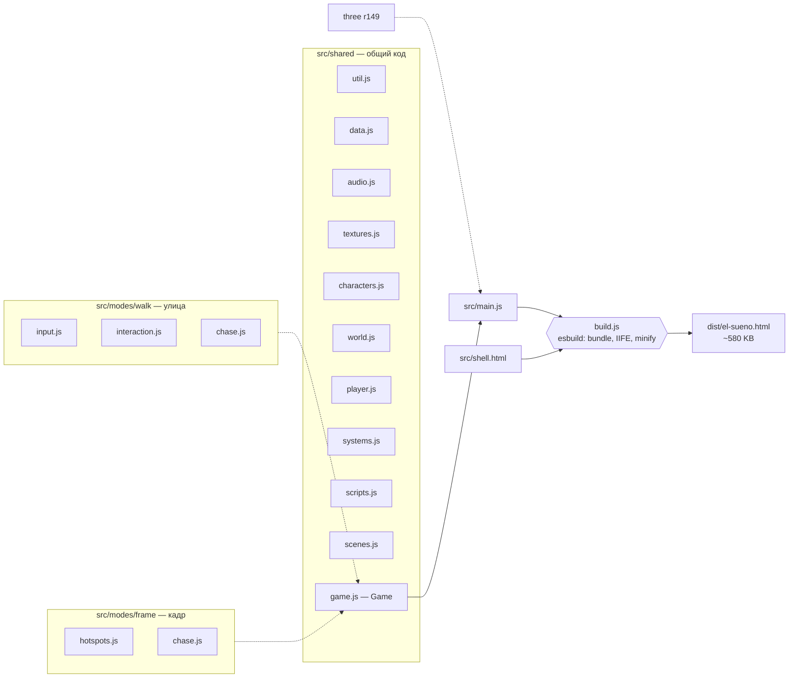
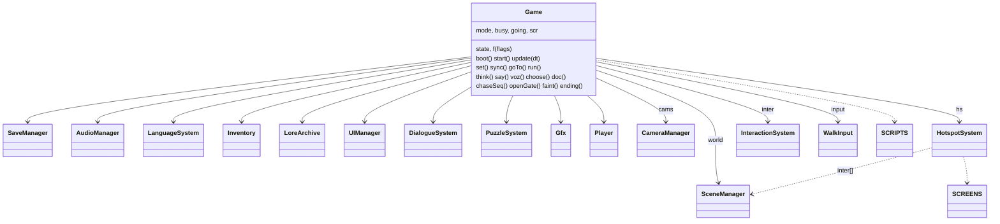
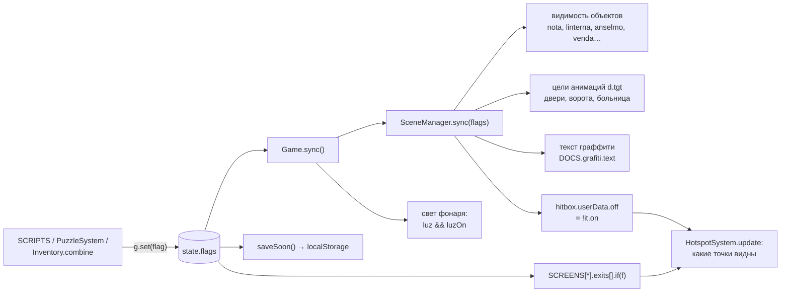
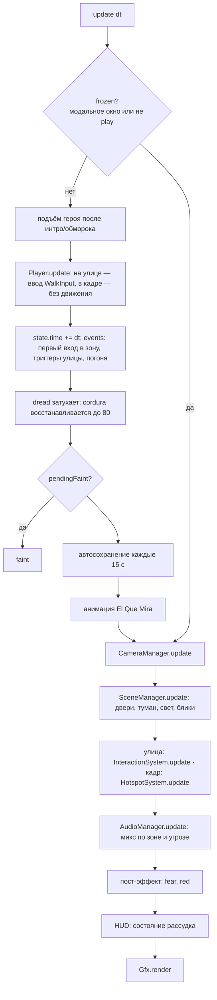
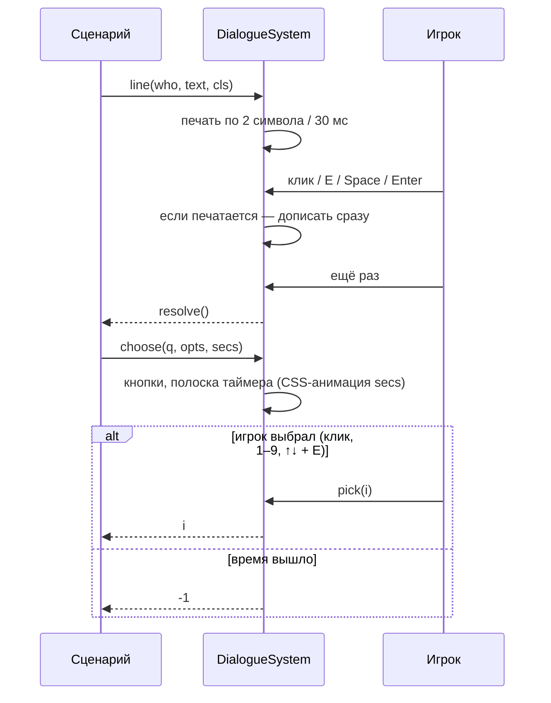

# Архитектура

## Обзор

Игра — один самодостаточный HTML-файл (`dist/el-sueno.html`). Код — ES-модули с явными `import`/`export`: общий — в `src/shared/`, поведение двух видов сцен — в `src/modes/walk/` (улица, ходьба) и `src/modes/frame/` (кадр с активными точками). `build.js` запускает esbuild (точная версия в `devDependencies`): bundle от `src/main.js` вместе с three.js (`import * as THREE from 'three'`, r149), формат IIFE, минификация, `target: es2020`. Результат встраивается в обычный `<script>` внутри `src/shell.html` (плейсхолдер `/*__GAME__*/`), поэтому файл работает через `file://`, без сервера и без `type="module"`.



`build.js` экранирует `</script` внутри бандла, чтобы встроенный скрипт не закрылся раньше времени, и использует функцию-заменитель в `String.replace`, чтобы `$` в коде не интерпретировался как шаблон подстановки. `package.json` объявляет `"type": "module"`: так `node --check` (хук после правки) понимает `import`, а `build.js` и `scripts/site.js` сами написаны как ESM.

Глобальных объявлений нет. Для тестов `main.js` выставляет `window.__sueno` (экземпляр `Game`) и `__sueno.three` (`THREE.REVISION`).

## Гибрид: улица и кадры, два режима игры

Один рантайм, одна сборка. В каждый момент игрок находится в одном из двух состояний:

| | Улица (`game.scr === null`) | Кадр (`game.scr` = id из `SCREENS`) |
|---|---|---|
| Что это | свободная ходьба: callejón, plaza, pasaje, подход к puerta | статичный план: tienda, quiosco, cabina, banco (Anselmo), pedestal |
| Ввод | `WalkInput`: WASD/стрелки, тап или клик по земле (герой идёт к точке), джойстик — опция | клики и тапы по кружкам и кнопкам выходов |
| Объекты | `InteractionSystem`: ближайший объект + `E`, клик/тап по объекту (герой подходит сам) | `HotspotSystem`: кружки `.hs` поверх проекции, панель `#nav` |
| Камера | по зонам (`CAMS[].test`) | камера кадра (`cams.base`) |

Переключение делает `Game`: `setScreen(id)` / `toStreet(pt)` без перехода, `goTo(id)`, `enterFrame(id)`, `exitFrame()` — с затемнением и звуком шагов. `syncHud()` прячет или показывает джойстик, `HotspotSystem.build()` — точки и выходы.

**Как попадают в кадр (режим normal).** У сцен в `SCREENS` есть `mode`:

- `mode: 'frame'` — кадр и в обычном режиме. Объект улицы, указанный в `hs` такой сцены (`periodico`, `telefono`, `anselmo`, `venda`, `pedestal`), при взаимодействии сначала открывает кадр (`frameOf(id)` → `Game.play` → `enterFrame`), затем выполняется его сценарий: разговор с Anselmo — это постановочный кадр. В tienda входят через дверь: триггер в `Game.events` срабатывает, когда герой пересекает открытый проём.
- `mode: 'walk'` — в обычном режиме это улица; как кадр сцена существует только в «Modo lectura».
- «→ Salir» (`exitFrame`) возвращает на улицу в точку входа (`state.ret`; если её нет — `out` сцены). `leaveIf(f)` закрывает кадр сам после сценария (pedestal — когда дверь открыта).

**Режимы игры** — настройка игрока (`modo` в настройках, кнопка на титуле и в паузе), а не отдельные сборки:

- **Modo: normal** (по умолчанию) — гибрид, описанный выше. Погоня в pasaje идёт в реальном времени (`modes/walk/chase.js`): идти навстречу преследователю — значит «посмотреть назад».
- **Modo: lectura** — все сцены — кадры, герой не ходит; между кадрами ведут выходы `exits`. Погоня — три выбора на время (`modes/frame/chase.js`, `chaseSeq`). Это бывшая квест-версия.

`Game.applyModo()` приводит партию в соответствие с режимом при старте, загрузке и смене настройки: улица ↔ кадр того же места (`screenAt(x, z)` и `at` сцены). Сменить режим нельзя во время сценария, перехода и погони. Флаги, предметы и решения общие, сохранение одно.

**Движение к точке** (`WalkInput.goTo`): направление на цель в мировых координатах; если герой не продвигается (упёрся в коллайдер), на короткое время отклоняется вбок, чередуя стороны и увеличивая время обхода; после нескольких неудач останавливается. Клавиши и джойстик отменяют движение к точке.

**Надписи на улице** (`auto: true` у `grafiti`, `pared`, `placa`): когда герой впервые оказывается рядом, документ открывается сам на весь экран.

## Модули

| Модуль | Что даёт |
|---|---|
| `shared/util.js` | `$`, `esc`, `clamp`, `PI`, `rng` (генератор с семенем) |
| `shared/data.js` | контент: `ZONES`, `ITEMS`, `DOCS`, `LEX`, `ARCHIVE`, `ECOS`, `SYMBOLS`, `PLATE_ORDER`, `PRAYER`, `SOLUTION`; ключи `SAVE_KEYS`, `LEGACY_SAVE_KEY`, `SET_KEY`; `MAX_SLOTS` |
| `shared/audio.js` | `AudioManager` (Web Audio, `speechSynthesis`) |
| `shared/textures.js` | процедурные текстуры: `TEX`, `buildTextures`, `canvasTex`, `textTex`, `paintText`, `paintTextRaw`, `scaleBoxUV` |
| `shared/characters.js` | параметрические модели персонажей: `makeBody(spec)`, спеки `HERO`, `ANSELMO`, `WATCHER`; `buildHero`/`animateHero`, `makeAnselmo`, `makeWatcher`; слой `CHAR_LAYER`, сила эффекта сна и `dreamUpdate` |
| `shared/world.js` | `SceneManager` (зоны, свет, коллайдеры, интерактивные объекты `addInter`, `sync` по флагам), `zoneAt`, `CAMS`, `CameraManager`, `Gfx` (низкое разрешение, эффект сна для персонажей, постпроцесс) |
| `shared/player.js` | `Player`: позиция, движение (относительно камеры или к точке мира), коллизии, фонарь; модель берёт из `characters.js` |
| `shared/systems.js` | `SaveManager({ key, from, validScr })`, `LanguageSystem`, `Inventory`, `LoreArchive`, `DialogueSystem` (выборы, в т. ч. на время), `PuzzleSystem`, `UIManager` |
| `shared/scripts.js` | `SCRIPTS` — сюжет, по async-функции на интерактивный объект; `DRINKS` |
| `shared/scenes.js` | `SCREENS` — сцены (`mode`, камера, место героя, точки, выходы), `frameOf(id)`, `screenAt(x, z)` |
| `shared/game.js` | `Game`: состояние, цикл, переходы между улицей и кадрами, режимы, события зон, ввод; `game` (live binding) |
| `modes/walk/input.js` | `WalkInput`: клавиши, джойстик, движение к точке с обходом препятствий |
| `modes/walk/interaction.js` | `InteractionSystem`: ближайший объект, луч от указателя, точка земли под указателем |
| `modes/walk/chase.js` | погоня в реальном времени: `startChase`, `updateChase`, `endChase` |
| `modes/frame/hotspots.js` | `HotspotSystem`: кружки поверх проекции, панель выходов |
| `modes/frame/chase.js` | `chaseSeq` — погоня через выборы на время (Modo lectura) |
| `main.js`, `shell.html` | проверка WebGL, `new Game().boot()`, `window.__sueno`; разметка и CSS |

`shared/` не зависит от `modes/`, кроме `game.js`, который их связывает. `SceneManager` обращается к игре через `this.game`. Действия на верхнем уровне — только регистрация сценариев фресок и Eco в `SCRIPTS` и таблица `frameOf` в `scenes.js`.



## Запуск

1. `main.js` проверяет WebGL; при ошибке показывает экран `#err` с текстом на испанском.
2. `new Game().boot()`: создаёт подсистемы, строит мир (`SceneManager.build`), игрока, камеры, точки; применяет флаги пустого состояния; вешает ввод; запускает `requestAnimationFrame`. Экземпляр доступен как `window.__sueno` (используется тестами).
3. Экран заголовка: «Continuar» (если есть сохранение), «Nueva partida» (с подтверждением, если сохранение есть), звук.
3а. Там же — кнопка режима «Modo: normal / lectura».
4. `Game.start(isNew)`: `audio.init()` (нужен жест пользователя), загрузка состояния, `setScreen(state.scr)` или `toStreet(state.pos)`, `applyModo()`, `sync()`, интро для новой игры.

## Состояние и поток данных

Всё состояние партии — один сериализуемый объект `state` (`SaveManager.fresh`):

```js
{ v: 1, scr: 'callejon1', pos: {x, z, ry}, flags: {}, inv: [], docs: [], words: [],
  archive: [], ecos: [], decisions: [], log: [], cordura: 100, time: 0, tries: 0 }
```

`game.f` — ссылка на `state.flags`. Мир не хранит собственного состояния сюжета: он выводится из флагов.



`SceneManager.sync(f)` **идемпотентна**: её можно вызвать сколько угодно раз с одними и теми же флагами и получить тот же мир. На этом построено восстановление сохранения — после загрузки достаточно `sync()` и `snap()` (мгновенно поставить анимируемые объекты в целевое положение без интерполяции).

## Игровой цикл

`requestAnimationFrame` → `Game.update(dt)` (`dt` ограничен 50 мс; исключение в кадре логируется один раз и не останавливает цикл).



**Рендер** (`Gfx`): сцена рисуется в render target низкого разрешения (высота ≤ 540 px), затем полноэкранный шейдер добавляет хроматическую аберрацию, зерно, виньетку, сканлайны, тонирование; uniforms `fear` (угроза/низкий рассудок) и `red` (после открытия двери) усиливают эффекты.

### Персонажи и «эффект сна»

**Модели** (`shared/characters.js`). `makeBody(spec)` собирает низкополигональное тело в духе PS1/PS2 из параметров: рост, телосложение (`build`), размер головы (`headK`, по умолчанию 1/7.5 роста), длина рук и ног, цвета и художники текстур (`torso`, `arm`, `leg`, лицо — `paintHead`), волосы (`long`/`short`), борода, очки, шляпа, повязка на глазах, шарф, светящийся глаз, поза. Каждая часть тела — одна сшитая сетка (`mergeBufferGeometries`) из тел вращения: торс, конечности, сужающиеся к концу, со скруглёнными суставами и плечами. Текстуры рисуются на canvas (лицо, складки, тени, нашивки); свет сверху, затемнение к ногам и в «пазухах» (под подбородком, подмышками) запекаются в цвета вершин. Скелета нет: шарниры — группы (бедро → колено, плечо → локоть, шея), их крутят `Player.update`/`animateHero` и `SceneManager.update`. Сейчас три спеки: протагонист (`HERO`), Anselmo (`ANSELMO`, сидит на скамейке), El Que Mira (`WATCHER`, без освещения, 2,9 м). Новый персонаж — новая спека.

**Слой и сила.** Все сетки персонажей лежат на слое 1 (`CHAR_LAYER`), свет включён для обоих слоёв, тень героя на земле — на слое 0 (это часть сцены). У каждого персонажа есть uniform `g.userData.dream` — сила эффекта; материалы пишут её в альфу (`onBeforeCompile`). Протагонист — 0.4, Anselmo — 1.0. El Que Mira — наоборот: `dreamUpdate()` каждый кадр делает его тем резче, чем он ближе к камере и центру экрана (вдали и с краю — 1.0, вплотную в центре — около 0.05). Его глаз не размывается никогда (своя сила 0.05).

**Проходы `Gfx.render` при «Efecto de sueño: sí»:**

1. Сцена (слой 0) → `rt` с текстурой глубины.
2. Персонажи (слой 1) → `rtC` в разрешении 3/4, с собственной глубиной и прозрачным фоном.
3. Эхо: `rtE` (пинг-понг, разрешение 3/4) хранит то, что недавно было видно от персонажа, и гасит его (`decay = 0.06^dt`): при движении остаётся шлейф.
4. Композиция → `rtM`, только в прямоугольнике вокруг видимых персонажей (проекция их ограничивающих сфер + запас на ореол и эхо за последние 1,2 с; scissor на самом render target). Персонаж виден, если его глубина меньше глубины сцены. Над ним: фильтр Кувахары (четыре квадранта по 2×2, радиус растёт с силой; то, что стирает детали, — Кувахара, размытие, дымка — идёт по квадрату силы, чтобы протагонист с 0.4 оставался узнаваемым), мягкий ореол из размытой маски покрытия, контур, растворяющийся по движущемуся шуму, лёгкая дымка (меньше насыщенности, чуть светлее и теплее), эхо. Всё усиливается со страхом (`fear`).
5. Пост-шейдер читает `rtM` внутри прямоугольника и `rt` вне его.

При «no» — один проход со всеми слоями, как раньше. Если ни одного персонажа не видно (и эхо погасло), проходы 2–4 не выполняются. Второй проход дешёвый: матрицы сцены не пересчитываются, а объекты окружения на время прохода скрываются, чтобы three не обходил их ещё раз. При смене камеры эхо и история прямоугольников сбрасываются (`CameraManager.onCut` → `Gfx.cut`). Прямоугольник считается по 8 углам локальной коробки каждого персонажа (только его сетки, без тени на земле); если камера разрезает коробку, берётся весь экран. Без текстур глубины (WebGL1 без `WEBGL_depth_texture`) эффект выключается сам (`Gfx.canDream`).

**Производительность** (`npm run perf`, headless Chromium + SwiftShader — абсолютные числа ниже, чем на GPU, сравнивать стоит только между собой; разброс между прогонами около ±10%):

| Сцена | 1280×720: старые модели | новые, эффект «no» | новые, эффект «sí» | 667×375: старые | «no» | «sí» |
|---|---|---|---|---|---|---|
| callejón | 24 | 28–30 | 23–24 | 50 | 54 | 45 |
| Anselmo (кадр) | 21 | 17–22 | 16–17 | 38 | 36 | 31 |
| plaza | 17–19 | 18 | 16–17 | 35 | 37 | 32 |
| pasaje + El Que Mira | 18–21 | 18–20 | 18–19 | 35 | 32 | 30 |

Включённый эффект против выключенного — минус 1–20%. Против старых моделей заметнее всего кадр Anselmo (около −20%): персонаж там крупный, и композиция покрывает большую часть экрана; в остальных сценах разница в пределах шума или до −15% на маленьком экране.

**Известные ограничения.** Полупрозрачные пелены тумана и блики точек (они не пишут глубину) не перекрывают персонажей: персонажи композируются поверх. Сравнение глубин нелинейное с небольшим допуском — дальний персонаж может чуть просвечивать сквозь тонкую стену.

**Камеры** (`CameraManager`): на улице камера выбирается по зоне (`test(x, z)`), у каждого кадра своя камера из `CAMS` (`pos`, `fov`, либо `fixed` — точка взгляда, либо слежение за героем с высотой `yoff`). `cams.force` временно перебивает камеру кадра (погоня — `pasaje2`, открытие двери — `verja`). В портретной ориентации FOV расширяется.

## Сцены и активные точки

`SCREENS` (`shared/scenes.js`) — 12 сцен (11 мест и крупный план pedestal). Сцена задаёт:

- `mode` — `'walk'` или `'frame'` (см. «Гибрид»); `out` — точка улицы по умолчанию при выходе; `leaveIf` — когда кадр закрывается сам;
- `cam` — id камеры из `CAMS`;
- `at`, `ry` — где стоит и куда смотрит герой;
- `hs` — список id активных точек;
- `exits` — выходы в «Modo lectura»: `{ label, to }` или `{ label, act: async g => … }`, с необязательным условием `if: f => …`. В обычном режиме у кадра один выход — «Salir».

Активная точка — это объект `it` из `SceneManager.addInter(id, x, z, opts)`: невидимый hitbox в 3D (его позиция проецируется на экран), блик-спрайт, глагол (`verb`) и условие `on()`. `HotspotSystem`:

- `build()` — при смене кадра создаёт по кнопке `.hs` на каждую точку кадра;
- `update()` — каждый кадр проецирует hitbox в экранные координаты (с прижатием к краям для портретного экрана), прячет выключенные точки и все точки, пока `!canAct()`; перерисовывает панель выходов `#nav`, только если изменилась её сигнатура;
- клик по точке → `Game.interact(it)` → `Game.run(g => g.play(id))` → `SCRIPTS[id]`;
- клик по выходу → `goTo(to)` (затемнение + шаги) или `run(act)`.

`Game.canAct()` = режим `play`, нет сценария (`busy`), нет перехода (`going`), нет модального окна, диалога и погони. `Game.canMove()` — то же, но погоня не мешает (идти можно). Пока сценарий выполняется, точки и выходы скрыты — это защищает от двойных действий.

## Сценарии

`SCRIPTS` — по async-функции на точку; сюжет читается сверху вниз. Хелперы `Game`:

| Хелпер | Что делает |
|---|---|
| `think(...lines)` | мысли героя (серый текст, без имени) |
| `say(who, ...lines)` | реплики персонажа; пишутся в журнал «Voces» |
| `voz(...lines)` | голос в телефоне: курсив + `speechSynthesis` |
| `choose(q, opts, secs?)` | выбор; возвращает индекс, `-1` при истечении таймера |
| `doc(id)` | открыть документ, добавить в Cuaderno, выучить слова, флаг `doc_<id>` |
| `give(id)` | положить предмет (`false`, если инвентарь полон) |
| `set(flag, v)` | флаг + `sync()` + отложенное сохранение |
| `arch(id)` | открыть фрагмент архива |
| `decide(text)` | записать решение |
| `addCordura(d)` | изменить рассудок; при 0 — отложенный обморок |
| `wait(ms)`, `camShake(v)`, `dread` | пауза, тряска камеры, всплеск угрозы для звука/шейдера |

`Game.run(fn)` выставляет `busy`, ловит исключения сценария (`console.error('guion', …)`), в `finally` скрывает диалог и ставит сохранение.

## Диалоги и выбор с таймером

`DialogueSystem` (`systems.js`):



Детали:

- после допечатки текст размечается словами словаря; новые слова дают звук и тост;
- `UIManager.guard()/guarded()` — защита от «синтетического» click того же касания, которое открыло панель (на тач-устройствах);
- клик по подчёркнутому слову в варианте ответа в первый раз показывает подсказку и не выбирает вариант;
- кнопкам снимается фокус после клика, чтобы Space/Enter при следующей реплике не нажали их повторно.

## Ввод

| Клавиша | Действие |
|---|---|
| W A S D / стрелки, Shift | ходьба и бег (на улице) |
| E / Space / Enter | действие с ближайшим объектом (на улице), продолжить реплику, выбрать подсвеченный вариант, закрыть документ |
| 1–9 | выбрать вариант |
| ↑ ↓ / W S | перемещение по вариантам |
| Tab | инвентарь |
| J | Cuaderno |
| F | фонарь (если собран) |
| M | звук вкл/выкл |
| Esc | закрыть окно / пауза |

Мышь и касание — по точкам, выходам, словам; на улице клик или тап по земле ведёт героя к точке, по объекту — к объекту с действием по прибытии. Джойстик (`#touch`) включается в паузе («Joystick: sí») и виден только на улице. Касание выставляет `body.touch` (другая раскладка подсказок). Жесты масштабирования, двойной тап и контекстное меню подавлены; прокрутка разрешена только в `.pbody`, `#docBody`, `.scroll`.

## Сохранение

`SaveManager` (`systems.js`):

- ключи `localStorage` (`data.js`): `SAVE_KEYS.hybrid` = `el_sueno_cap1_v2` — партия; `el_sueno_ajustes_v1` — настройки: громкость, звук, озвучка, `modo` (`normal`/`lectura`), `joy` (джойстик);
- формат `v: 2`: к полям v1 добавлены `scr` — текущий кадр или `null` (герой на улице, тогда важна `pos`) и `ret` — точка улицы, куда вернёт «Salir»;
- миграция v1 → v2 (`SaveManager.migrate`): если партии v2 нет, берётся первая из старых — квест (`el_sueno_cap1_quest_v1`), общий ключ (`el_sueno_cap1_v1`), ходьба (`el_sueno_cap1_walk_v1`). Квест хранил кадр (`scr`), ходьба — только позицию; `Game.applyModo()` при загрузке превращает кадр-улицу в точку на улице. Старые ключи не удаляются. Покрыто `tests/e2e_saves.py`;
- если `localStorage` недоступен (приватный режим, `file://` с ограничениями) — хранение в памяти, на титульном экране предупреждение «Este navegador no guarda la partida.»;
- когда сохраняется: `saveSoon()` (debounce 400 мс) после флагов, предметов, архива, переходов; автосохранение раз в 15 с при `canAct()`; при открытии паузы; кнопка «Guardar partida»; `visibilitychange` (скрытие вкладки); `pagehide`.

**Валидация при загрузке** (`SaveManager.load`) — испорченное сохранение не ломает игру:

| Поле | Проверка |
|---|---|
| весь объект | JSON-объект с `v === 2`, иначе сохранение удаляется |
| `flags` | объект (не массив), иначе `{}` |
| `inv` | только существующие id `ITEMS`, не больше `MAX_SLOTS` (6) |
| `docs`, `archive`, `ecos` | только существующие id `DOCS`, `ARCHIVE`, `ECOS` |
| `words`, `decisions` | только строки |
| `log` | записи со строковым `t`, последние 60 |
| `pos` | конечные числа, зажаты в границы карты |
| `scr` | существующий id `SCREENS`, иначе `null` (улица) |
| `ret` | только вместе с `scr`: конечные числа, зажаты в границы карты |
| `cordura` | число, зажато в `[10, 100]` |
| `time`, `tries` | конечные числа |

При исключении сохранение удаляется (`console.warn('Guardado dañado: se ignora.')`), игра стартует как новая. Это покрыто e2e-тестом («guardado dañado se ignora»).

Изменение формата `state` требует поднять `v` и/или ключи `SAVE_KEYS`.

## Звук

`AudioManager` — полностью процедурный Web Audio: дроун (пилы через waveshaper и фильтр с медленным «риффом»), ветер, электрический гул у фонарей/автомата, шум радио, слой угрозы (саб-бас, диссонансный кластер, сердцебиение), случайные события по зонам (металл, капли, стук, голоса, FM-колокола, глитч), свёрточный реверб с генерируемым импульсом и эхо. `Game.update` каждый кадр передаёт в `audio.update` зону, угрозу, близость к источникам гула/радио/телефона. Контекст создаётся только по жесту пользователя (требование Safari/iOS) и приостанавливается при скрытии вкладки.
