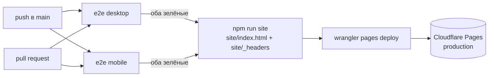

# Деплой

Игра — один статический файл, бэкенд не нужен. Выбранная площадка — **Cloudflare Pages**: бесплатно, HTTPS, CDN, сжатие brotli/gzip, свой домен.

## Как это устроено



- `.github/workflows/ci.yml`: на каждый push в `main` и на каждый pull request — сборка и e2e в двух режимах (параллельно). Деплой — только для push в `main` и только если оба теста прошли. Скриншоты тестов сохраняются как артефакты (14 дней).
- `npm run site` собирает `dist/el-sueno.html` и готовит каталог `site/`: игра копируется как `index.html`, рядом кладётся `deploy/cloudflare/_headers`. Каталог `dist/` не меняется — `dist/el-sueno.html` по-прежнему открывается через `file://`.
- `deploy/cloudflare/_headers` — заголовки для всех путей:

| Заголовок | Значение | Зачем |
|---|---|---|
| `Content-Security-Policy` | `default-src 'none'; script-src 'unsafe-inline'; style-src 'unsafe-inline'; img-src data: blob:; media-src data: blob:; base-uri 'none'; form-action 'none'; frame-ancestors 'none'` | страница не загружает ничего внешнего; всё встроено, поэтому разрешены только inline-скрипты и стили |
| `X-Content-Type-Options` | `nosniff` | |
| `X-Frame-Options` | `DENY` | запрет встраивания в iframe (дублирует `frame-ancestors`) |
| `Referrer-Policy` | `no-referrer` | |
| `Permissions-Policy` | камера, микрофон, геолокация и т. п. запрещены | игре они не нужны |
| `Cross-Origin-Opener-Policy` | `same-origin` | |
| `Cache-Control` | `no-cache` | имя файла не меняется между версиями, поэтому браузер каждый раз сверяет ETag и получает 304 без тела, если версия та же; после деплоя игроки сразу получают новую версию |

HTTPS и HSTS Cloudflare включает сам (HSTS — в настройках домена, см. ниже).

## Первая настройка (один раз)

### 1. Репозиторий на GitHub

```sh
# создайте пустой репозиторий на github.com (без README), затем:
git remote add origin git@github.com:<user>/el-sueno.git
git push -u origin main
```

Первый push запустит тесты; деплой упадёт, пока не настроены секреты (шаги 2–4) — это ожидаемо.

### 2. Проект в Cloudflare Pages

1. Зарегистрируйтесь на [dash.cloudflare.com](https://dash.cloudflare.com).
2. Скопируйте **Account ID**: на главной странице аккаунта, справа в блоке «Account details» (или в URL: `dash.cloudflare.com/<account_id>/…`).
3. Создайте проект типа **Direct Upload** (деплой из GitHub Actions, а не через интеграцию Cloudflare с Git). Проще всего локально:

   ```sh
   npx wrangler@4 login
   npx wrangler@4 pages project create el-sueno --production-branch=main
   ```

   Или в панели: **Workers & Pages → Create → Pages → Upload assets**, имя проекта `el-sueno`. Имя проекта станет адресом: `https://el-sueno.pages.dev` (если имя занято — выберите другое и см. шаг 4, переменная `CF_PAGES_PROJECT`).

### 3. API-токен

**My Profile → API Tokens → Create Token → Create Custom Token**:

- Permissions: **Account → Cloudflare Pages → Edit**;
- Account Resources: ваш аккаунт;
- сохраните токен — он показывается один раз.

### 4. Секреты GitHub

В репозитории: **Settings → Secrets and variables → Actions**.

| Тип | Имя | Значение |
|---|---|---|
| Secret | `CLOUDFLARE_API_TOKEN` | токен из шага 3 |
| Secret | `CLOUDFLARE_ACCOUNT_ID` | Account ID из шага 2 |
| Variable (необязательно) | `CF_PAGES_PROJECT` | имя проекта, если оно не `el-sueno` |

Workflow использует окружение `production` (Settings → Environments создастся автоматически). Там можно включить ручное подтверждение деплоя (**Required reviewers**), если нужно.

### 5. Первый деплой

Перезапустите workflow (**Actions → CI → Run workflow** на `main`) или сделайте любой push в `main`. После зелёного прогона игра доступна на `https://<project>.pages.dev`.

### 6. Свой домен (необязательно)

**Workers & Pages → el-sueno → Custom domains → Set up a custom domain**:

- если домен уже обслуживается Cloudflare — DNS-запись создастся автоматически;
- если нет — добавьте у своего регистратора `CNAME` для поддомена (например, `sueno.example.com → el-sueno.pages.dev`); для корневого домена Cloudflare потребует перенести DNS-зону к себе.

Сертификат выпускается автоматически. HSTS включается для домена в **SSL/TLS → Edge Certificates → HTTP Strict Transport Security**.

## Обновление

Обычный цикл: изменения → pull request (тесты) → merge в `main` → тесты → автодеплой. Каждый деплой виден в **Workers & Pages → el-sueno → Deployments** с хешем коммита.

Ручной деплой с локальной машины (минуя CI — только в крайнем случае, тесты не запускаются):

```sh
npx wrangler@4 login     # один раз
npm run deploy           # сборка + site/ + wrangler pages deploy
```

## Откат

- **Быстро (без кода):** Workers & Pages → el-sueno → **Deployments** → нужный предыдущий деплой → **⋯ → Rollback to this deployment**. Продакшен мгновенно переключается на старую версию.
- **Через git:** `git revert <commit>` → push в `main` → CI протестирует и задеплоит версию без проблемного изменения. Этот путь предпочтительнее: история и продакшен остаются согласованными.

## Проверка после деплоя

```sh
curl -sI https://el-sueno.pages.dev/ | grep -iE 'HTTP/|content-security|cache-control|content-encoding'
```

Ожидается `200`, заголовки из таблицы выше. Затем — открыть игру в браузере, начать новую партию, дойти до площади.

Те же заголовки можно проверить до деплоя: тест `E2E_URL=<адрес> python3 tests/e2e.py` проходит главу по любому http-адресу, а не по `file://`.
