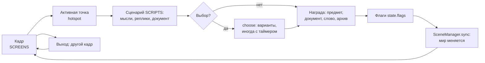
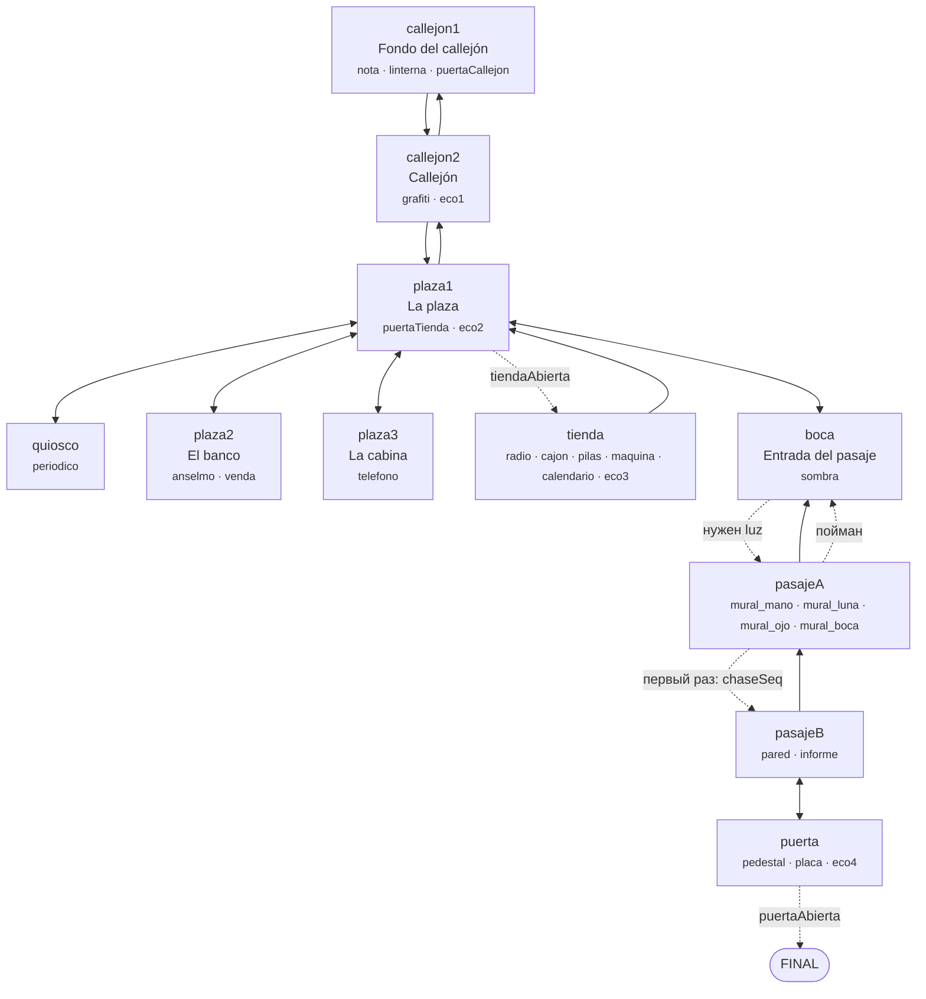
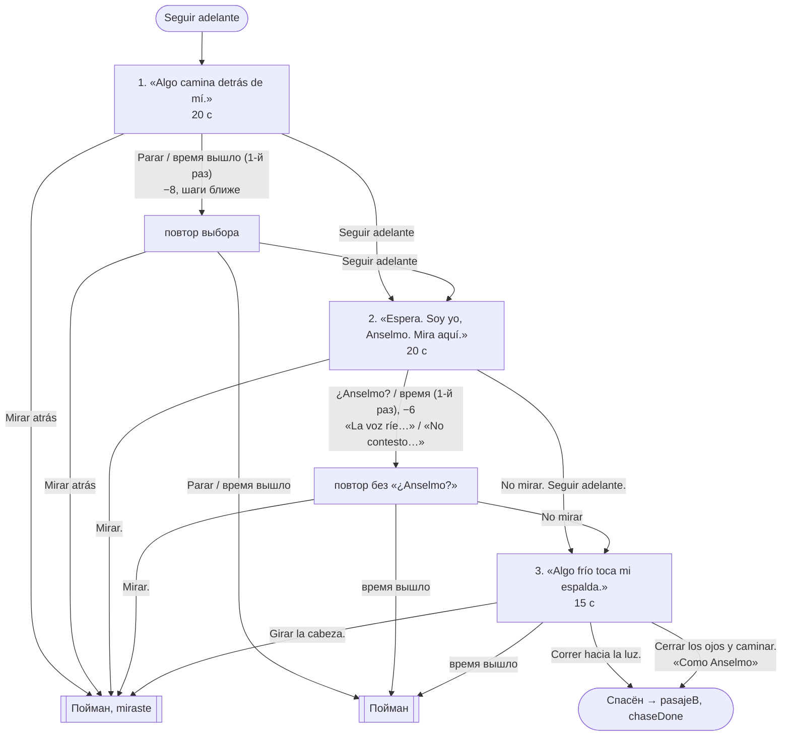

# Гейм-дизайн: EL SUEÑO — Capítulo I: La Ciudad Vacía

Документ описывает главу I в том виде, в каком она реализована в `src/`. Все ссылки на код — на текущие файлы; если код и документ расходятся, прав код.

## Концепция

Психологический хоррор в формате кинематографичного квеста (в духе Telltale / Snatcher). Игрок не ходит: смотрит на фиксированные 3D-кадры, нажимает на активные точки, читает документы и выбирает реплики. Весь игровой текст — на кастильском испанском уровня A1.

Герой просыпается в пустом туманном городе и не помнит своего имени. Город застрял в одной дате (7 ноября), жители «спят», телефон называет героя «пациент семь». Чтобы выйти, нужно пройти через тёмный пассаж, не оглядываясь, и открыть северную дверь, прочитав молитву «наоборот». Дверь оказывается не выходом, а входом — в больницу.

## Принципы

1. **Язык — это механизм понимания мира.** Почти каждое препятствие решается не ловкостью, а пониманием испанской фразы: «TIRA» на двери, «No quiero agua» у Anselmo, «NO MIRES ATRÁS» на стене, «REZA AL REVÉS» на табличке. Подробно — в [LANGUAGE_DESIGN.md](LANGUAGE_DESIGN.md).
2. **Чем лучше понимаешь, тем страшнее.** Тексты, которые сначала выглядят бытовыми (газета, календарь, справка), складываются в картину: город — сон пациентов больницы Santa Vigilia, а герой — пациент № 7. Раздел «Archivo» явно разделяет факт, свидетельство и гипотезу и оставляет выводы игроку.
3. **Ошибка — это последствие, а не game over.** Неправильный выбор снижает «cordura» (рассудок), приводит к погоне назад или к обмороку, но не стирает прогресс.
4. **Нет ходьбы — есть взгляд.** Перемещение — это смена кадра через панель выходов; темп задаёт чтение, а не моторика.

## Игровая петля

Каждое действие что-то даёт: предмет в инвентарь, документ в Cuaderno, новые слова в Diccionario, фрагмент в Archivo или открытый Eco. Новые слова подсвечиваются в тексте; по нажатию на слово показывается определение на простом испанском.

### Рассудок (cordura)

| Событие | Изменение | Где |
|---|---|---|
| Старт | 100 | `SaveManager.fresh` |
| Стук за дверью в переулке (первый раз) | −4 | `SCRIPTS.puertaCallejon` |
| Толкнуть дверь с надписью «TIRA» | −6 | `SCRIPTS.puertaTienda` |
| Неверный ответ в Eco | −7 | эхо в `game.js` |
| Верный ответ в Eco | +18 | эхо в `game.js` |
| Выпить напиток | +12 | `Game.useItem` |
| Погоня: «Parar» в первый раз | −8 | `Game.chaseSeq` |
| Погоня: «¿Anselmo?» | −6 | `Game.chaseSeq` |
| Пойман в погоне | −30 | `Game.chaseSeq` → `caught` |
| Неверная комбинация плит | −9 | `PuzzleSystem.check` |
| Пассивное восстановление | +0.7/с, но не выше 80 | `Game.update` |

Индикатор в HUD: глаз со зрачком и подпись `Tranquilo` (>70), `Nervioso` (>40), `Miedo` (>15), `Pánico` (≤15 или во время угрозы). Низкий рассудок усиливает пост-эффект (зерно, аберрация, дрожание).

При рассудке 0 срабатывает **обморок** (`Game.faint`): затемнение, «Todo está oscuro.», герой просыпается снова в `callejon1` с рассудком 60. В журнал решений пишется «El miedo te duerme una vez.»

## Карта сцен

11 кадров из `src/screens.js`. Пунктир — переход с условием или со сценарием.

| Кадр | Камера | Активные точки | Выходы |
|---|---|---|---|
| `callejon1` | `callA` | nota, linterna, puertaCallejon | Seguir por el callejón → `callejon2` |
| `callejon2` | `callB` | grafiti, eco1 | Salir a la plaza → `plaza1`; Volver al fondo del callejón → `callejon1` |
| `plaza1` | `plazaS` | puertaTienda, eco2 | El quiosco, El banco, La cabina, La tienda (*если `tiendaAbierta`*), El pasaje, El callejón |
| `quiosco` | `quiosco` | periodico | Volver a la plaza |
| `plaza2` | `plazaNW` | anselmo, venda | Volver a la plaza |
| `plaza3` | `plazaNE` | telefono | Volver a la plaza |
| `boca` | `pasaje1` | sombra | Entrar en el pasaje (*сценарий: без `luz` — «Necesito luz.»*); Volver a la plaza |
| `tienda` | `tienda` | radio, cajon, pilas, maquina, calendario, eco3 | Salir a la plaza |
| `pasajeA` | `pasajeA` | mural_mano, mural_luna, mural_ojo, mural_boca | Seguir adelante (*сценарий: погоня, если не `chaseDone`*); Salir a la plaza → `boca` |
| `pasajeB` | `pasaje2` | pared, informe | Ir a la puerta; Volver por el pasaje |
| `puerta` | `puerta` | pedestal, placa, eco4 | Cruzar la puerta (*если `puertaAbierta`*: финал); Volver al pasaje |

Активная точка показывается, только если её условие `on()` в `world.js` истинно (например, `nota` исчезает после прочтения, `anselmo` — после открытия двери, Eco — пока не решено и выполнено его условие).

При первом попадании в зону (`v_<zona>`) герой произносит вступительную мысль: plaza — «Una plaza. No hay nadie. Un teléfono suena.», tienda, pasaje, puerta — свои реплики (`Game.events`).

## Полное прохождение главы I

Ниже — оптимальный путь. Порядок внутри шагов 3–9 частично свободный.

1. **Интро.** Чёрный экран: «No recuerdas tu nombre.» → «Abres los ojos.» Герой встаёт в переулке: «Hace frío. Hay mucha niebla. ¿Dónde estoy?»
2. **`callejon1`.**
   - `nota` → документ «Nota mojada» («Si lees esto, estás dormido… Busca la luz. Busca al hombre que no duerme. — M.»).
   - `linterna` → предмет «Linterna» (без батареек).
   - `puertaCallejon` → дверь заперта; впервые — стук изнутри (флаг `golpes`, −4).
3. **`callejon2`.** `grafiti` → «NO MIRES ATRÁS». Выход на площадь.
4. **`plaza1`** (первый визит: `plazaVisitada`, звонит телефон).
   - **Quiosco** → `periodico` (архив «La ciudad vacía»; открывает `eco1`).
   - **Cabina** → `telefono`: «Paciente siete. ¿Está despierto?» Выбор из трёх ответов (запоминается в решениях), предупреждение «No abra la puerta del norte… el hombre de la plaza… miente». Из телефона выпадает **moneda** (`llamada1`, архив «La voz del teléfono»).
   - **Banco** → `anselmo`: знакомство (архив «Anselmo, el farolero»), просьба: «Quiero un refresco de naranja. No quiero agua. Y el café no me gusta.» (`anselmoSed`). Можно расспросить: ¿Quién eres? / ¿Dónde estoy? / ¿Cómo salgo de aquí? / ¿Quién llama por teléfono?
5. **Дверь магазина** (`puertaTienda`): на двери «TIRA». «Empujar» — шум, −6; «Tirar de la puerta» — открыто (`tiendaAbierta`), появляется выход «La tienda».
6. **`tienda`.**
   - `pilas` → «Pilas». В инвентаре: Linterna → Combinar → Pilas = «Linterna con pilas» (`luz`, `luzOn`).
   - `maquina` с монетой → выбрать **NARANJA**.
   - По желанию: `radio` («…la puerta no es la salida. Es la entrada…»), `calendario` («Hoy es 7. Ayer también.»).
7. **Anselmo** → «Toma. Es para ti. (Refresco de naranja)» → **llave** «TIENDA — CAJÓN» (`tieneLlave`). Открывается вопрос про повязку («Porque él mira… En el pasaje, camina. No mires atrás. Nunca.»).
8. **`tienda` → `cajon`** → «Usar la llave pequeña» → документ «Oración del Ojo Cerrado» + предмет «Fotografía» (архивы «La Orden del Ojo Cerrado», «Proyecto Vigilia»). Можно решить `eco3`.
9. **`boca`** → «Entrar en el pasaje» (без света — отказ; фонарь включается автоматически).
10. **`pasajeA`**: четыре фрески `mural_*` (LA MANO, LA LUNA, EL OJO, LA BOCA) → архив «Mano, luna, ojo, boca».
11. **«Seguir adelante» → погоня** (см. ниже). Правильно: «Seguir adelante» → «No mirar. Seguir adelante.» → «Correr hacia la luz.» или «Cerrar los ojos y caminar.»
12. **`pasajeB`**: `informe` (Paciente n.º 7, «duerme desde 1987», «puerta»; архивы «El paciente siete», «El doctor Ferrán»), `pared` («ÉL TE MIRA / SI TÚ LO MIRAS»).
13. **`puerta`**: `placa` («PARA ENTRAR, REZA. PARA SALIR, REZA AL REVÉS.»), `eco4`, `pedestal` → загадка: **boca → ojo → luna → mano**. Дверь открывается (`puertaAbierta`): «Detrás hay una calle. La niebla es roja.»
14. **После открытия двери (необязательно, но раскрывает лор):**
    - Banco: Anselmo исчез, на скамейке `venda` (архив «El banco vacío»).
    - Cabina: второй звонок (`llamada2`): «Vuelva a su habitación. Ahora.» — «Sí, doctor.» / «No.»
    - Quiosco: газета изменилась: «El paciente siete abre la puerta».
    - Pintada: «ÉL YA NO MIRA. AHORA MIRAS TÚ.»
    - `callejon1` → `puertaCallejon`: дверь открыта, за ней больничная палата с тёплой пустой кроватью (архив «La puerta del callejón»).
    - `eco2` у фонтана (доступен после погони), `eco1`.
15. **«Cruzar la puerta» → финал.**

## Сюжетные флаги

Все флаги хранятся в `state.flags` (объект `g.f`), выставляются через `Game.set(flag, v)` (сразу синхронизирует мир и ставит сохранение в очередь). Исключения отмечены.

### Документы и визиты

| Флаг | Когда | На что влияет |
|---|---|---|
| `doc_<id>` | при открытии любого документа (`Game.doc`): `doc_nota`, `doc_grafiti`, `doc_periodico`, `doc_cartel`, `doc_calendario`, `doc_oracion`, `doc_pared`, `doc_informe`, `doc_placa`, `doc_radio` | `doc_nota`/`doc_informe` прячут бумагу в мире; `doc_cartel` — не показывать табличку повторно; `doc_periodico` открывает `eco1`; `doc_oracion` открывает `eco4` и меняет реплики у `placa` и подсказку загадки; `doc_placa` открывает вопрос Anselmo «¿Qué es "al revés"?» |
| `doc_periodico2` | газета прочитана после открытия двери | нигде не читается (зарезервирован) |
| `v_<zona>` | первый вход в зону (`v_plaza`, `v_tienda`, `v_pasaje`, `v_puerta`; `v_callejon` — при возвращении) | вступительная мысль один раз |
| `plazaVisitada` | первый вход на площадь | начинает звонить телефон |

### Предметы

| Флаг | Когда | На что влияет |
|---|---|---|
| `got_linterna`, `got_pilas`, `got_foto` | предмет подобран | предмет исчезает из мира / не выдаётся повторно |
| `luz` | собран фонарь с батарейками (`Inventory.combine`) | можно войти в пассаж |
| `luzOn` | фонарь включён (при сборке, при входе в пассаж, клавиша F) | свет фонаря героя |
| `monedaPend` | монета из телефона не влезла в инвентарь | монету можно забрать позже |
| `monedaExtra` | Anselmo дал свою последнюю монету | текст «Toma otra moneda» при повторе |

### Персонажи и диалоги

| Флаг | Когда |
|---|---|
| `golpes` | первый стук за дверью переулка |
| `llamada1` | первый звонок отвечен (выдаёт монету) |
| `llamada2` | второй звонок (после открытия двери) |
| `anselmo` | первая встреча с Anselmo |
| `anselmoSed` | Anselmo попросил напиток |
| `bebidaMal` | ему принесли не тот напиток (в решения: «Llevas a Anselmo una bebida que no quiere.») |
| `tieneLlave` | Anselmo отдал ключ за апельсиновую газировку |
| `q_quien`, `q_donde`, `q_salir`, `q_ojos`, `q_tel`, `q_reves`, `q_foto` | заданы соответствующие вопросы Anselmo |
| `tiendaAbierta` | дверь магазина открыта «на себя» |
| `cajonAbierto` | ящик открыт ключом |
| `cajonVacio` | из ящика всё забрано — точка исчезает |
| `sombraVista` | увидена тень у входа в пассаж (или вход в пассаж) |

### Пассаж, дверь, финал

| Флаг | Когда | На что влияет |
|---|---|---|
| `mural_mano`, `mural_luna`, `mural_ojo`, `mural_boca` | осмотрена фреска | все четыре → архив «Mano, luna, ojo, boca» |
| `chaseDone` | пережита погоня | «Seguir adelante» больше не запускает погоню; открывает `eco2`; меняет граффити и даёт архив «El Que Mira» у `pared` |
| `miraste` | герой оглянулся в погоне. **Пишется напрямую** `g.f.miraste = true` | граффити «MIRASTE.» / «NO MIRASTE. BIEN.»; итог в статистике |
| `pedestalVisto` | первый осмотр пьедестала | вступительная реплика один раз |
| `puertaAbierta` | загадка решена | меняет мир: исчезает Anselmo (остаётся повязка), открывается дверь переулка, красный туман, видна больница, второй звонок, новые тексты газеты и граффити, выход «Cruzar la puerta» |
| `fin` | финал. **Пишется напрямую** | — |

## Загадка с плитами

Пьедестал у северной двери: четыре круглые плиты в порядке `PLATE_ORDER` = луна, рот, рука, глаз (`src/data.js`). Нужно нажать четыре плиты по очереди.

- Табличка: «PARA ENTRAR, REZA. PARA SALIR, REZA AL REVÉS.»
- Молитва из ящика (`oracion`): «Primero, la mano apaga la luz. Después, la luna sube. Luego, el ojo se cierra. Al final, la boca calla.» → `PRAYER` = mano, luna, ojo, boca.
- Решение `SOLUTION` = молитва наоборот: **boca, ojo, luna, mano**.

Реакции (`PuzzleSystem.check`):

| Ввод | Сообщение | Последствия |
|---|---|---|
| boca, ojo, luna, mano | «Algo muy grande se mueve dentro de la pared.» | дверь открывается (`openGate`), кат-сцена камеры `verja` |
| mano, luna, ojo, boca (молитва «для входа») | «Las placas suben otra vez. Esa es la oración para entrar. Tú no quieres entrar.» | `tries++`, −9 |
| другое, ≥3 попыток и молитва не найдена | «Nada. Necesitas las palabras de la oración. No están aquí.» | `tries++`, −9 |
| другое | «Nada. Las placas suben otra vez. Detrás de ti, algo respira.» | `tries++`, −9 |

Фрески в пассаже показывают те же символы в порядке молитвы; архив подсказывает: «Cuando entras al pasaje, los ves en ese orden. Cuando sales, los ves al revés.»

## Погоня в пассаже

`Game.chaseSeq` — три момента, каждый с выбором на время (полоска таймера над вариантами). Истечение таймера возвращает `-1` и трактуется как бездействие. Камера переключается на `pasaje2` (вид снизу, против героя), за спиной появляется El Que Mira.

**Пойман** (`caught`): удар, −30 рассудка, возврат в `boca`: «Estoy otra vez en la entrada del pasaje. En el callejón había unas palabras en la pared...» — прямая подсказка вернуться к граффити «NO MIRES ATRÁS». Если оглянулся — ставится `miraste` и решение «En el pasaje, miras atrás.»

**Спасён**: `chaseDone`, переход в `pasajeB`, архив «El Que Mira». Если не оглядывался ни разу — решение «En el pasaje, no miras atrás.»; при закрытых глазах — «En el pasaje, cierras los ojos, como Anselmo.»

## Концовка

«Cruzar la puerta» (`Game.ending`) — серия титров на чёрном фоне:

1. «Cruzas la puerta.»
2. «Delante de ti hay un hospital. En todas las ventanas hay luz.»
3. «En tu brazo hay una pulsera. Antes no estaba.»
4. «PACIENTE 7»
5. «Una voz dice: «Bienvenido a casa.»»

Открываются архивы «El paciente siete» и «Tres ideas», ставится `fin`, игра сохраняется. Экран итогов (7 строк): время во сне, понятые слова `n / 76`, документы `n / 10`, фрагменты архива `n / 12`, Ecos `n / 4`, «¿Miraste atrás?», попытки у двери. Ниже — анонс «Capítulo II: El Hospital».

Финал однозначен по событиям, но не по смыслу: что такое больница — реальность, общий сон пациентов или ещё один слой сна — решает игрок (см. [LORE.md](LORE.md), «Три интерпретации»).

## Решения (журнал)

`Game.decide(text)` записывает выборы игрока в `state.decisions` (без дублей). Возможные записи: ответ на первый звонок (3 варианта), «Empujas una puerta que dice «tira».», «Llevas a Anselmo una bebida que no quiere.», «Das el refresco de naranja a Anselmo.», «Anselmo dice que el teléfono miente.», «Anselmo dice que es el paciente número tres.», варианты поведения в погоне, «Abres la puerta del norte.», ответ на второй звонок, «El miedo te duerme una vez.» В главе I решения пока не отображаются в интерфейсе — это задел для следующих глав.
